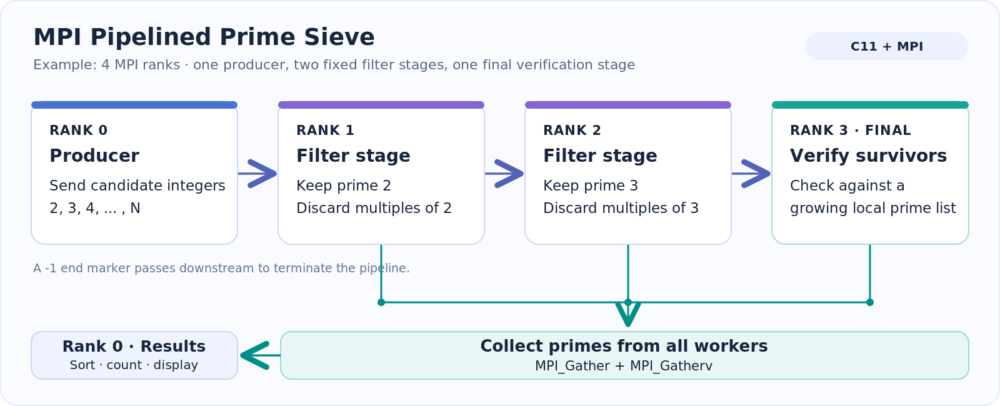

# MPI Pipelined Prime Sieve

**A distributed prime-number sieve written in C using MPI.** This project demonstrates how a stream of candidate numbers can move through cooperating processes, with each stage filtering values and the results collected back at the producer.

**Tech stack:** C11 · MPI · Make · Python 3 (optional tests)

## Architecture



*Illustration for `mpirun -np 4`: one producer and three worker ranks. Other process counts create different numbers of filtering stages.*

The sieve follows four steps:

1. **Produce — Rank 0:** Send candidate integers from `2` through the input limit to the first worker with `MPI_Send`.
2. **Filter — Intermediate ranks:** Each worker retains the first prime it receives, removes its multiples, and forwards surviving candidates to the next rank.
3. **Verify — Final rank:** Use a growing local list of primes to check candidates that pass through the earlier filters. This allows the program to find more primes than there are worker processes.
4. **Collect — Rank 0:** Use `MPI_Gather` and `MPI_Gatherv` to collect the primes, then sort and display them.

A sentinel value of `-1` marks the end of the stream and is forwarded through the pipeline for clean termination.

## Build and run

**Requirements:** An MPI implementation such as Open MPI or MPICH, with `mpicc` and `mpirun` (or `mpiexec`), plus a C compiler.

```bash
make
mpirun -np 4 ./pipelined_sieve 100
```

Or compile without the Makefile:

```bash
mpicc -std=c11 -O2 -Wall -Wextra -Wpedantic pipelined_sieve.c -o pipelined_sieve
mpirun -np 4 ./pipelined_sieve 100
```

Here, `-np 4` starts four MPI ranks: **one producer and three workers**. The program requires at least two ranks and an integer limit of at least `2`.

For an upper limit of **100**, there are **25 primes**. The program lists every prime when the limit is at most `1000`; for larger limits, it displays the first 20 and the total count. It also reports elapsed time for the computation and result collection.

## Repository structure

```text
Pipelined_Sieve_Code/
├── pipelined_sieve.c      # MPI sieve implementation
├── Makefile               # Build with mpicc
├── tests/
│   └── test_sieve.py      # Integration checks across limits and rank counts
├── docs/
│   └── images/
│       ├── mpi-pipeline.png
│       └── mpi-pipeline.svg
├── .gitignore
└── README.md
```

## Testing

An optional Python integration test compares the MPI program's output against a reference sieve using multiple input limits and process counts.

```bash
python3 tests/test_sieve.py
```

The test requires a working MPI installation.

## Implementation notes

- **Streaming message passing:** Blocking `MPI_Send` and `MPI_Recv` connect the filtering stages.
- **Coordinated result collection:** `MPI_Gather` and `MPI_Gatherv` return the workers' results to Rank 0.
- **Correctness beyond the pipeline length:** The final worker verifies candidates against primes discovered locally, rather than assuming that every prime needs its own MPI rank.
- **Performance trade-offs:** Sending one integer per message introduces communication overhead, and work is not equally distributed across workers. This implementation prioritizes the MPI pipeline design over speed.

## Key concepts

**MPI · Parallel computing · Distributed algorithms · Pipelining · Prime sieve · Message passing · Process synchronization**
